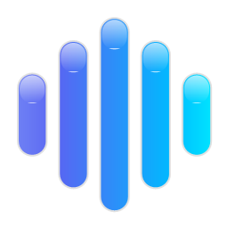
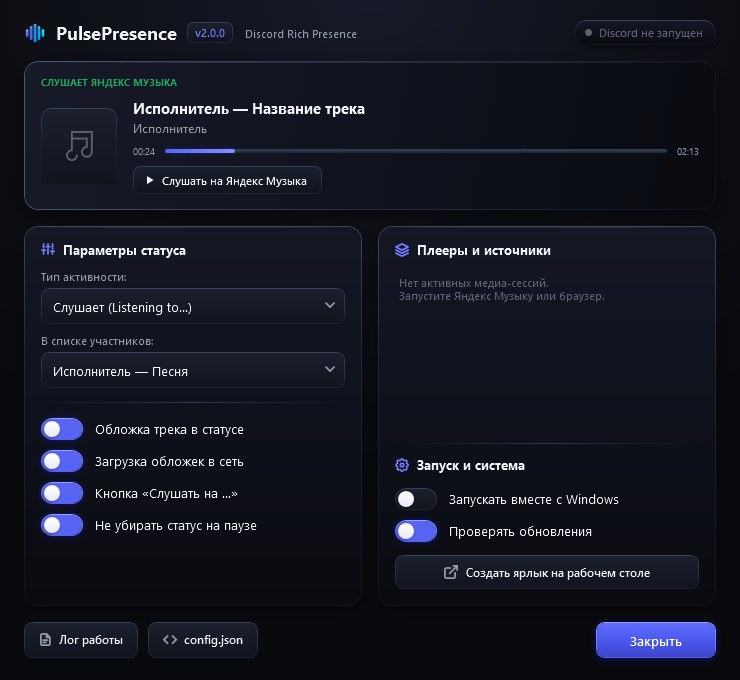

<div align="center">



# PulsePresence

**Твой музыкальный ритм и трек из любого приложения в статусе Discord.**

Яндекс Музыка, Spotify, YouTube Music, VK Музыка, SoundCloud, Telegram, Браузер (Chrome, Opera, Edge), AIMP, foobar2000 — всё, что играет в Windows.

[](https://github.com/callmainplz/PulsePresence/releases/latest)
[](https://github.com/callmainplz/PulsePresence/releases)
[](https://github.com/callmainplz/PulsePresence/stargazers)
[](https://t.me/martdoma)
[](https://github.com/callmainplz/PulsePresence)
[](LICENSE)

<br/>

Русский · **[English](README.md)**

<br/>

[**⬇ Скачать PulsePresence.exe (v2.0.0)**](https://github.com/callmainplz/PulsePresence/releases/latest/download/PulsePresence.exe)

<br/>



</div>

---

## ⚡ Особенности PulsePresence 2.0

* **Стиль Liquid Glass:** Тёмная полупрозрачная эстетика матового стекла, чёткие векторные SVG-иконки без лишних эмодзи.
* **Умный статус под плеер:** В Discord пишется *"Слушает Яндекс Музыка"*, *"Слушает YouTube Music"*, *"Слушает SoundCloud"* или выбранный плеер с индивидуальным Client ID.
* **Гибкая настройка списка участников:**
  - `Исполнитель — Песня` (например: `Кишлак — 11:11`)
  - `Песня — Исполнитель` (например: `11:11 — Кишлак`)
  - `Исполнитель`
  - `Название трека`
  - `Откуда играет: SoundCloud, Telegram…`
  - `Название приложения Discord`
* **Чистый вид карточки:** Название плеера не дублируется снизу третьей строкой, если оно уже указано в заголовке.
* **Чёткая и прозрачная иконка в трее:** Ромбовидный неоновый эквалайзер с 100% прозрачным фоном, отрисованный без размытия для экранов с любым масштабированием (100%, 125%, 150%, 200% DPI).
* **Мгновенная загрузка обложек:** Обложка читается напрямую из Windows Media Session и выгружается в облако в фоновом потоке без задержек трека.
* **Минимальное потребление ресурсов:** Чистый .NET Framework 4.8 и чистый WPF. Никаких сторонних библиотек, ~35 МБ ОЗУ и 0% нагрузки на процессор.

---

## 💬 Поддержка и сообщения об ошибках

Если нашли баг, есть идея или вопрос:
* Telegram: **t.me/martdoma** (`@martdoma`)
* GitHub Issues: [callmainplz/PulsePresence/issues](https://github.com/callmainplz/PulsePresence/issues)

---

## 🚀 Быстрый старт

1. Скачайте **`PulsePresence.exe`** из раздела [Releases](https://github.com/callmainplz/PulsePresence/releases/latest).
2. Запустите файл. Иконка эквалайзера появится в системном трее рядом с часами.
3. В Discord проверьте: **Настройки пользователя → Конфиденциальность активности → «Отображать текущую активность в статусе»** должно быть включено.
4. Включите любой трек в Яндекс Музыке, браузере или любом другом плеере!

---

## 🛠 Сборка из исходников

PulsePresence собирается стандартным компилятором MSBuild, встроенным в .NET Framework 4.8 в любой Windows 10 и 11:

```powershell
powershell -ExecutionPolicy Bypass -File build.ps1
```

Готовый файл `PulsePresence.exe` появится прямо в папке проекта.

---

## 📄 Лицензия

Проект распространяется под свободной лицензией [MIT](LICENSE).
